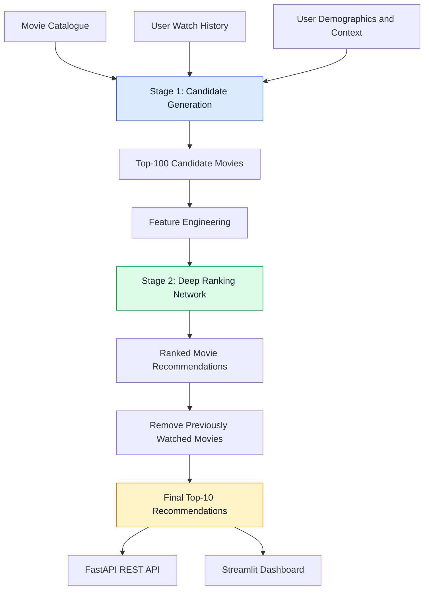

# DeepRec — A Two-Stage Deep Learning Video Recommendation System


> **Research foundation:** Inspired by *Deep Neural Networks for YouTube Recommendations* by Paul Covington, Jay Adams, and Emre Sargin (ACM RecSys 2016).

## 1. Project Overview

DeepRec implements a two-stage recommendation architecture inspired by YouTube's recommendation system.

Recommendation systems must identify relevant items from large catalogues while maintaining good recommendation quality and low latency. A two-stage architecture separates candidate retrieval from detailed ranking.

### Stage 1 — Candidate Generation
A neural network converts a user's chronological watch history and contextual information into a user representation. It retrieves a shortlist of potentially relevant movies from the catalogue.

### Stage 2 — Deep Ranking
A ranking network evaluates the retrieved candidates using user, item, historical interaction, rating, popularity, and genre-affinity features. The candidates are then ranked to produce personalized recommendations.

**Technology stack:** Python, PyTorch, FastAPI, Streamlit, and the MovieLens 100K dataset.

The project includes chronological data splitting, leakage prevention, baseline comparisons, offline evaluation, a REST API, and an interactive dashboard.


## 2. System Architecture

The system follows a two-stage recommendation pipeline: candidate generation retrieves relevant movies, and the ranking model orders them to produce personalized recommendations.


## 2. System Architecture




## 3. Model Implementation

### Stage 1: Candidate Generation

- **Input:** Chronological item history, age, gender, and occupation.
- **Embeddings:** Learn dense representations of items and categorical user attributes.
- **History representation:** Masked average pooling excludes padding tokens.
- **Neural network:** Configurable MLP with hidden dimensions `[128, 64]`, LayerNorm, ReLU, and dropout.
- **Training objective:** Sampled softmax classification with negative sampling.
- **Retrieval:** Calculate user-to-item scores using vectorized matrix multiplication and retrieve the highest-scoring candidates.

### Stage 2: Deep Ranking

The ranking model evaluates each candidate using features such as:

- Candidate-generation score
- Item popularity and rating statistics
- User interaction count and historical mean rating
- Interaction recency
- Movie release year
- User-item genre affinity
- User and movie embeddings

Continuous features are standardized using training-set statistics. Selected features are augmented with power transforms:

\[
x,\quad x^2,\quad \sqrt{x}
\]

The ranking network uses an MLP with hidden dimensions `[128, 64, 32]` and a sigmoid probability output. Training uses binary cross-entropy with logits, with ratings of 4.0 or higher treated as positive engagement.

## 4. Benchmark Results

The following table contains the reported experimental results. Reproduce the experiments to verify these figures before presenting them as independently validated results.

| Experiment | Model | Recall@10 | Recall@50 | Precision@10 | NDCG@10 | MAP@10 | Coverage | Latency |
|---|---|---:|---:|---:|---:|---:|---:|---:|
| A | Popularity Baseline | 0.0267 | 0.1100 | 0.0027 | 0.0117 | 0.0069 | 3.80% | 0.01 ms |
| B | Item-Item Collaborative Filtering | 0.0533 | 0.2967 | 0.0053 | 0.0268 | 0.0182 | 62.96% | 0.06 ms |
| C | Shallow Candidate Net [64] | 0.0433 | 0.1167 | 0.0043 | 0.0173 | 0.0089 | 15.22% | 0.77 ms |
| D | Deep Candidate Net [128, 64] | 0.0867 | 0.2667 | 0.0087 | 0.0387 | 0.0232 | 49.23% | 0.88 ms |
| E | Candidate Net + Context | 0.0867 | 0.2667 | 0.0087 | 0.0387 | 0.0232 | 49.23% | 0.81 ms |
| F | Two-Stage, Pool 100 | 0.0367 | 0.2167 | 0.0037 | 0.0193 | 0.0137 | 49.35% | 2.13 ms |
| G1 | Two-Stage, Pool 50 | 0.0533 | 0.2667 | 0.0053 | 0.0276 | 0.0194 | 49.23% | 1.94 ms |
| G2 | Two-Stage, Pool 200 | 0.0300 | 0.1500 | 0.0030 | 0.0169 | 0.0127 | 47.98% | 2.75 ms |

**Reported finding:** The deep candidate-generation model achieves approximately 3.25× the Recall@10 of the popularity baseline, with catalogue coverage increasing from 3.80% to 49.23%.

These results are dataset- and experiment-specific; they do not establish production-scale performance.

## 5. Repository Structure

```text
DeepRec/
├── README.md
├── RDS_ProjectPaper.pdf
├── requirements.txt
├── .gitignore
├── .gitattributes
├── configs/
│   └── model.yaml
├── data/
│   ├── raw/ml-100k/
│   └── processed/
├── artifacts/
│   ├── candidate/
│   ├── ranking/
│   └── evaluation/
├── docs/
│   ├── paper_implementation_mapping.md
│   ├── architecture.md
│   ├── data_dictionary.md
│   ├── experiments.md
│   └── limitations.md
├── src/
│   └── deeprec/
│       ├── __init__.py
│       ├── config.py
│       ├── data/
│       │   ├── download.py
│       │   ├── inspect.py
│       │   ├── preprocess.py
│       │   ├── sequences.py
│       │   ├── dataset.py
│       │   └── ranking_features.py
│       ├── models/
│       │   ├── candidate_generation.py
│       │   ├── ranking.py
│       │   └── baseline.py
│       ├── training/
│       │   ├── losses.py
│       │   ├── train_candidates.py
│       │   └── train_ranker.py
│       ├── retrieval/
│       │   └── retrieve.py
│       ├── evaluation/
│       │   ├── metrics.py
│       │   ├── evaluate.py
│       │   └── experiments.py
│       ├── service/
│       │   └── recommender.py
│       └── api/
│           └── main.py
├── dashboard/
│   └── app.py
└── tests/
    ├── test_data.py
    ├── test_sequences.py
    ├── test_candidate_model.py
    ├── test_ranking_model.py
    ├── test_metrics.py
    ├── test_recommender.py
    └── test_api.py
```

This tree documents the intended project structure. Ensure each listed file exists before claiming the implementation is complete.

## 6. Installation and Execution

Commands below are for Windows PowerShell, executed from the repository root.

### Step 1: Set up the environment

```powershell
py -3.11 -m venv .venv
.\.venv\Scripts\Activate.ps1
python -m pip install --upgrade pip
python -m pip install -r requirements.txt
```

### Step 2: Download and inspect the dataset

```powershell
python -m src.deeprec.data.download
python -m src.deeprec.data.inspect
python -m src.deeprec.data.preprocess
```

### Step 3: Train the models

```powershell
python -m src.deeprec.training.train_candidates --epochs 10
python -m src.deeprec.training.train_ranker --epochs 10
```

### Step 4: Evaluate the recommendations

```powershell
python -m src.deeprec.evaluation.evaluate
python -m src.deeprec.evaluation.experiments --max_users 300
```

### Step 5: Run tests

```powershell
python -m pytest tests -v
```

### Step 6: Start the REST API

```powershell
uvicorn src.deeprec.api.main:app --host 127.0.0.1 --port 8000 --reload
```

API documentation: [http://127.0.0.1:8000/docs](http://127.0.0.1:8000/docs)

### Step 7: Launch the dashboard

Open a second PowerShell terminal, activate the virtual environment, and run:

```powershell
streamlit run dashboard/app.py
```

Dashboard: [http://localhost:8501](http://localhost:8501)

## 7. REST API Endpoints

| Method | Endpoint | Description |
|---|---|---|
| GET | `/health` | Service status, device, and model artifact status |
| GET | `/movies` | Paginated movie catalogue with genre filters |
| GET | `/recommendations/{user_id}` | Personalized recommendations with scores |
| POST | `/interactions` | Record a user interaction |
| GET | `/metrics` | Retrieve saved evaluation metrics |

Endpoint availability depends on the implemented API routes.

## 8. Evaluation Methodology

DeepRec evaluates recommendation quality and system performance using:

- **Recall@K:** Fraction of relevant items retrieved in the top K.
- **Precision@K:** Fraction of recommended items that are relevant.
- **NDCG@K:** Ranking quality with higher weight for relevant items near the top.
- **MAP@K:** Mean average precision across users.
- **Catalogue coverage:** Fraction of catalogue items recommended.
- **Latency:** Time required to generate recommendations.

Chronological train/validation/test splitting helps prevent future interactions from leaking into training. Preprocessing statistics and feature transformations should be fitted on training data only.

## 9. Limitations and Future Work

- **Watch duration:** MovieLens 100K does not provide continuous video watch-duration data.
- **Large catalogues:** Approximate nearest-neighbor retrieval, such as FAISS, could replace exact matrix multiplication at larger scales.
- **Online evaluation:** Offline metrics cannot replace live A/B testing.
- **Ranking performance:** Candidate-generation improvements do not guarantee improvements in the complete two-stage pipeline.
- **Reproducibility:** Reported benchmark results should be verified against the saved experiment outputs and evaluation protocol.

For further details, see:

- [Paper Implementation Mapping](docs/paper_implementation_mapping.md)
- [Architecture](docs/architecture.md)
- [Experiments](docs/experiments.md)
- [Limitations](docs/limitations.md)

## 10. License

This project declares the MIT License. Add a `LICENSE` file containing the appropriate MIT license text before distributing the repository under that license.
