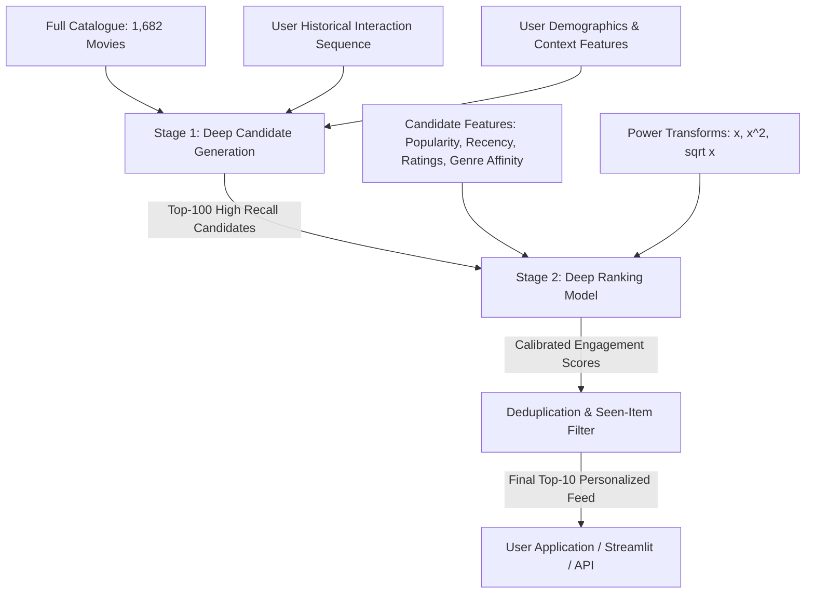
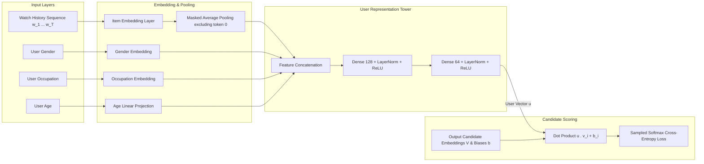
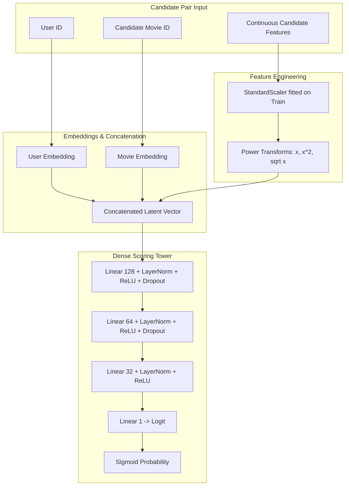

# DeepRec System Architecture

DeepRec implements a two-stage deep learning recommendation architecture inspired by Google's landmark paper, *"Deep Neural Networks for YouTube Recommendations"* (Covington, Adams, and Sargin, 2016).

---

## 1. High-Level Recommendation Funnel

The system structures the recommendation problem as a sequential two-stage funnel:

---

## 2. Stage 1: Deep Candidate Generation (Retrieval)

The candidate generation network formulates recommendation as predicting the next watched video given a user's chronological watch history.

### Key Mathematical Formulations:
1. **User Embedding:**
   $$\bar{e}_u = \frac{1}{\sum_{t=1}^T \mathbb{I}(w_t \neq 0)} \sum_{t=1}^T e(w_t) \cdot \mathbb{I}(w_t \neq 0)$$
   $$u = \text{MLP}([\bar{e}_u \,\|\, \text{context}_u])$$

2. **Scoring Function:**
   $$s(u, i) = u^\top v_i + b_i$$

3. **Sampled Softmax Objective:**
   $$\mathcal{L}_{CG} = -\log \frac{\exp(s(u, y^+))}{\exp(s(u, y^+)) + \sum_{j=1}^K \exp(s(u, y_j^-))}$$

---

## 3. Stage 2: Deep Ranking (Scoring & Reranking)

The ranking network receives the top $K=100$ candidate items from Stage 1 and computes a precise engagement score using candidate-level interaction features.

### Continuous Features and Non-linear Power Transforms:
As described in Covington et al. (Section 4.1), continuous features are normalized and transformed with powers:
$$\mathbf{x}_{\text{continuous}} = [x, \, x^2, \, \sqrt{x}]$$
Continuous features include:
1. `candidate_score`: Logit score from Stage 1 retrieval.
2. `item_popularity`: Normalized interaction frequency in training split.
3. `item_avg_rating`: Bayesian smoothed mean rating.
4. `item_rating_count_log`: $\log(1 + \text{item rating count})$.
5. `user_mean_rating`: Historical average rating given by user.
6. `user_count_log`: $\log(1 + \text{total user ratings})$.
7. `genre_affinity`: Cosine similarity between user's historical genre vector and candidate movie genre vector.
8. `interaction_recency`: Logarithm of elapsed days since user's previous interaction.
9. `release_year`: Normalized movie release year.
